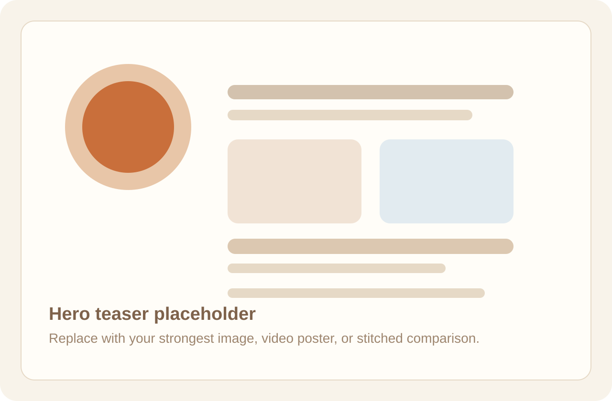

# ReCal3R Project Page

This repository is a lightweight static project page scaffold for a CV / 3D research paper demo site. It is designed for the common workflow where the training and rendering code live in a separate research repository, while this repo only hosts the presentation layer.

## Goals

- Keep the site static and easy to deploy.
- Match the feel of common paper project pages without depending on a heavy frontend framework.
- Make it easy to swap placeholder content for real assets exported from your research codebase.
- Work cleanly on GitHub Pages, including deployment under a repository subpath such as `https://username.github.io/repo-name/`.

## Directory Structure

```text
.
├── .gitignore
├── .nojekyll
├── README.md
├── index.html
└── static
    ├── css
    │   └── style.css
    ├── images
    │   ├── comparison-placeholder.svg
    │   ├── comparisons
    │   │   └── .gitkeep
    │   ├── method-placeholder.svg
    │   ├── result-placeholder-01.svg
    │   ├── result-placeholder-02.svg
    │   ├── result-placeholder-03.svg
    │   ├── results
    │   │   └── .gitkeep
    │   └── teaser-placeholder.svg
    ├── js
    │   └── app.js
    ├── models
    │   └── .gitkeep
    └── videos
        └── .gitkeep
```

## How to Preview Locally

Because this page uses relative asset paths, preview it through a local static server instead of opening `index.html` directly.

### Option 1: Python

```bash
python3 -m http.server 8000
```

Then open:

```text
http://localhost:8000/
```

### Option 2: VS Code Live Server

If you use VS Code, any simple static server extension works fine.

## How to Replace Placeholder Content

### Core text

Edit `index.html` and replace:

- project title
- author list
- affiliations
- button links
- abstract
- method bullets
- acknowledgement text
- BibTeX entry

### Images

Replace placeholder SVG files or change the `` paths in `index.html`.

Suggested mapping from your research repo outputs:

- `demo.py --export_png ... --transparent --skip_viewer`
  - teaser render
  - object cutout render
  - comparison stills
- `run_birds_eye_plot.sh`
  - top-down figure
- `render_ttt3r_offscreen.py`
  - fixed-view render
  - stitched qualitative images
  - optional `PLY` export for future interactive viewers

### Videos

Put videos under:

```text
static/videos/
```

Then replace an image block like:

```html

```

with:

```html
<video controls autoplay muted loop playsinline poster="static/images/recal3r-teaser.webp">
  <source src="static/videos/teaser.mp4" type="video/mp4" />
</video>
```

### 3D assets

Place exported meshes or point clouds under:

```text
static/models/
```

This scaffold does not yet include an in-browser model viewer. If you want one later, you can add a lightweight viewer in a separate iteration without changing the overall page structure.

## Why Relative Paths Matter

All local assets are referenced with relative paths like:

```html
static/css/style.css
static/images/teaser-placeholder.svg
static/js/app.js
```

This is important because GitHub Pages project sites are usually served from a subpath:

```text
https://username.github.io/repo-name/
```

Relative paths keep the page working in both:

- local preview
- GitHub Pages project-site deployment

## GitHub Pages Deployment

### Fastest path: deploy from `main`

1. Push this repo to GitHub.
2. Open repository `Settings`.
3. Go to `Pages`.
4. Under `Build and deployment`, choose:
   - `Source`: `Deploy from a branch`
   - `Branch`: `main`
   - `Folder`: `/ (root)`
5. Save and wait for GitHub Pages to publish.

Your site will appear at:

```text
https://username.github.io/repo-name/
```

### Optional custom domain

Later, if you want a personal domain, GitHub Pages also supports adding a custom domain in the same settings panel.

## Suggested Next Edits

1. Replace the hero teaser with your strongest visual.
2. Replace the method placeholder with a paper-quality figure.
3. Add 3 to 6 real qualitative examples.
4. Add 1 to 3 stitched baseline comparisons.
5. Replace placeholder links with paper, code, demo, and slides URLs.

## Notes

- The page is intentionally framework-free: just HTML, CSS, and JS.
- `.nojekyll` is included to keep GitHub Pages simple and predictable.
- The current design is an MVP scaffold, but it is already structured to look like a real research project page rather than a generic landing page.
